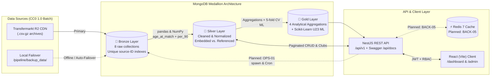

<div align="center">

# ⚽ MercatoIQ

**European Football Performance & Financial Intelligence Platform ("Moneyball" Analytics)**  
*Connecting on-pitch player output with transfer fees and market valuations across the UEFA Champions League & Top 5 European Leagues (2012–present).*

[](https://www.python.org/)
[](https://pandas.pydata.org/)
[](https://scikit-learn.org/)
[](https://nestjs.com/)
[](https://www.mongodb.com/)
[](https://redis.io/)
[](https://vitejs.dev/)

[Architecture](#-medallion--system-architecture) · [Provenance & Schema](#-data-provenance-volume--schema) · [Analytical Questions & ML](#-the-4-analytical-questions-gold-layer--ml) · [Triggers & CLI](#-pipeline-triggers--cli) · [Quick Start](#-quick-start--environments) · [Tests & CI](#-testing-load-benchmarking--ci) · [Team](#-team--git-flow)

</div>

---

## 🧭 Medallion & System Architecture

MercatoIQ ingests **>100,000 unique observations** (`202,914` distinct documents in our local seed) from [`dcaribou/transfermarkt-datasets`](https://github.com/dcaribou/transfermarkt-datasets) into a three-tier **MongoDB Medallion Architecture (`Bronze -> Silver -> Gold`)** orchestrated in Python and served by a versioned **NestJS REST API (`/api/v1`)** consumed by a **React (Vite) Web Application**.



### Architectural & Software Design Patterns
- **Medallion Data Architecture (`Bronze -> Silver -> Gold`):** Separates immutable-keyed raw ingestion, cleaned operational entities, and pre-aggregated analytical read models.
- **Hybrid Document Modeling (`Embedded` vs. `Referenced`):** Tailors MongoDB schemas in `silver_*` to read cardinality and document size bounds.
- **Modular DI & Layered REST (`Module -> Controller -> Service -> Mongoose Model`):** Enforces separation of concerns in NestJS, backed by strict DTO validation (`ValidationPipe` with `whitelist` & `forbidNonWhitelisted`) and declarative security (`APP_GUARD` `JwtAuthGuard` + `RolesGuard` with `@Public()` / `@Roles()`).
- **Idempotent Batch Upsert & Failover Strategy:** Python ETL uses `pymongo` `UpdateOne(..., upsert=True)` against unique keys plus automatic fallback from R2 CDN to local `.csv.gz` backups.
- **Client Server-State Caching & Opt-In Demo Mode:** React views use TanStack Query v5 (`keepPreviousData`) paired with an Axios JWT interceptor and an opt-in offline fixture adapter (`DemoModeContext`). Server-side Redis Cache-Aside is tracked in `BACK-05` (`#43`, `#44`).

---

## 📦 Data Provenance, Volume & Schema

### Source, License & Collection Mode
- **Primary Source:** [`dcaribou/transfermarkt-datasets`](https://github.com/dcaribou/transfermarkt-datasets) served as gzipped CSV files from Cloudflare R2 (`TRANSFERMARKT_CDN_BASE`), with automatic failover to `/pipeline/backup_data/`.
- **License & Reuse:** **CC0 1.0 Universal (Public Domain)** — open, redistributable, and reusable for analytical and academic processing.
- **Collection Mode & Scope:** **Periodic batch collection** *(not real-time sensor streaming)* filtered to seasons **`2012`–present** across the **Top 5 European Leagues (`GB1`, `ES1`, `IT1`, `L1`, `FR1`) + UEFA Champions League (`CL`)**.
- **Uniqueness Guarantee (>100,000 Observations):** Each Bronze document enforces a MongoDB `unique: true` index on its natural or deterministic source key. Duplicate re-imports update existing records via `upsert=True`, and neither derived Silver/Gold collections nor aggregates are counted toward the 100,000 observation minimum.

### Bronze Collections (202,914 Distinct Verified Source Observations)

| Collection | Local Seed Count* | What 1 Observation Represents | Unique Index Key | Key Fields Retained |
| :--- | :---: | :--- | :--- | :--- |
| `bronze_competitions` | `6` | 1 target European competition | `["competition_id"]` | `competition_id`, `name`, `country_name`, `type` |
| `bronze_clubs` | `796` | 1 football club | `["club_id"]` | `club_id`, `name`, `domestic_competition_id`, `squad_size`, `total_market_value` |
| `bronze_players` | `35,000` | 1 registered player | `["player_id"]` | `player_id`, `name`, `date_of_birth`, `position`, `current_club_id`, `market_value_in_eur` |
| `bronze_games` | `27,112` | 1 official match (`>= 2012`, target competitions) | `["game_id"]` | `game_id`, `competition_id`, `season`, `date`, `home_club_id`, `away_club_id` |
| `bronze_appearances` | `35,000` | 1 player-match performance sheet | `["appearance_id"]` | `appearance_id`, `game_id`, `player_id`, `club_id`, `competition_id`, `minutes_played`, `goals`, `assists`, `yellow_cards`, `red_cards` |
| `bronze_game_events` | `35,000` | 1 in-match event (goal, card, substitution) | `["game_event_id"]` | `game_event_id`, `game_id`, `minute`, `type`, `player_id`, `player_in_id` |
| `bronze_player_valuations` | `35,000` | 1 historical market value snapshot on a date | `["player_id", "date"]` | `player_id`, `date`, `market_value_in_eur`, `current_club_id` |
| `bronze_transfers` | `35,000` | 1 player club-to-club transfer movement | `["transfer_id"]` *(deterministic)* | `transfer_id` (`player_id_date_from_to`), `player_id`, `transfer_date`, `transfer_season`, `from_club_id`, `to_club_id`, `transfer_fee`, `market_value_in_eur` |

*\*Verified with `python3 pipeline/check_bronze.py` using `--limit 35000` (local dev cap); uncapped full-history ingestion exceeds 1.5M distinct source rows.*

### Silver Layer Design: Embedded vs. Referenced & Indexes

| Pattern | Target Collection(s) | Local Count | Indexes Provisioned | Architectural Justification |
| :--- | :--- | :---: | :--- | :--- |
| **Embedded** | `silver_players` | `35,000` | `player_id` *(unique)*, `(position, current_market_value_eur)`, `current_club.competition_id` | Embeds `current_club` summary (`{ club_id, name, competition_id }`) and up to 10 recent `market_valuations` snapshots directly inside each player document for single-query profile reads with zero joins. |
| **Referenced** | `silver_appearances`<br/>`silver_transfers` | `35,000`<br/>`35,000` | `appearance_id` *(unique)*, `(competition_id, season, player_id, position)`; `transfer_id` *(unique)*, `(to_club_id, season)` | Uses indexed references (`player_id`, `game_id`, `club_id`, `competition_id`, `season`) because active players accumulate 500+ match sheets and clubs execute hundreds of transfers across seasons. |

### EDA & Bronze -> Silver -> Gold Processing
1. **Sanitization & Schema Validation (`bronze_ingest.py`):** Verifies required CSV columns early, converts `NaN`/empty strings to Mongo `null`, stamps `_ingested_at` / `_source`, and enforces `MIN_SEASON=2012` + `TARGET_COMPETITIONS`.
2. **Vectorized Normalization (`silver_transform.py`):** Uses `pandas` and `NumPy` to compute `age_at_match` from `date_of_birth`, vectorized per-90 rates `(stat / minutes_played) * 90` guarded against zero minutes, parsed integer `season` keys (`24/25 -> 2024`), and embedded club/valuation summaries.
3. **Analytical Aggregations & ML (`gold_layer.py`):** Materializes pre-joined, sorted documents into the 4 Gold collections so the NestJS API serves paginated/filtered responses without client-side aggregation.

---

## 🎯 The 4 Analytical Questions (Gold Layer & ML)

| # | Analytical Question | Gold Collection | Local Count | Key Metrics Exposed | Status |
| :---: | :--- | :--- | :---: | :--- | :---: |
| **Q1** | **Club Financial Transfer ROI:** *Which clubs achieve the highest value gain & offensive output per EUR spent on transfers?* | `gold_club_transfer_roi` | `6,608` | `total_fees_paid_eur`, `total_value_gain_eur`, `roi`, `ga_per_m_eur` | ✅ **Live** |
| **Q2** | **U23 Talent Scouting + ML (+5pt Bonus):** *Which U23 players outperform their market value based on `per_90` output and our ML model?* | `gold_undervalued_scouting` | `452` | `market_value_eur`, `estimated_value_eur`, `undervalue_ratio` | ✅ **Live** |
| **Q3** | **Big-Match Pressure (UCL vs. Domestic):** *Which players step up or drop off in the UEFA Champions League (`CL`) vs. Top 5 domestic leagues?* | `gold_ucl_vs_domestic` | `362` | `ucl_goals_per_90`, `domestic_goals_per_90`, `goals_per_90_delta` | ✅ **Live** |
| **Q4** | **Late-Game Super-Subs:** *Which substitutes generate the highest decisive goal contribution rate off the bench?* | `gold_super_subs` | `810` | `sub_appearances`, `sub_goal_contributions_per_90`, `super_sub_score` | ✅ **Live** |

### Detailed Methodology for Two Core Analyses

#### 1. Q1 — Club Financial Transfer ROI (`gold_club_transfer_roi`)
- **Data Used:** `silver_transfers` (`to_club_id`, `season`, `transfer_fee_eur`, `market_value_at_transfer_eur`), `silver_appearances` (`goals`, `assists` grouped by `club_id`, `season`), and `bronze_clubs` (`name`, `domestic_competition_id`).
- **Method (`pandas` / `NumPy`):** Computes per-transfer `value_gain_eur = market_value_eur - fee_eur`, aggregates spending and valuation gains by `(club_id, season)`, joins club-season offensive contributions (`total_ga = total_goals + total_assists`), and computes `roi = total_value_gain_eur / total_fees_paid_eur` and `ga_per_m_eur = total_ga / (total_fees_paid_eur / 1e6)` whenever `total_fees_paid_eur > 0` (`null` on free/zero-spend windows to avoid division-by-zero distortion).
- **Expected Result & Decision Support:** Highlights clubs generating positive market-value appreciation and goal contributions per million EUR invested, enabling sporting directors to benchmark recruitment efficiency across leagues and seasons.

#### 2. Q2 — U23 Undervalued Scouting via Machine Learning (`gold_undervalued_scouting` — ML Bonus)
- **Data Used:** `silver_appearances` grouped by `(player_id, season)`, enriched with `silver_players` (`current_market_value_eur`, `date_of_birth`, `position`) and `bronze_clubs`. Filtered to **`age <= 23`**, **`minutes_played >= 450`** *(minimum 5 full-match equivalents)*, and strictly positive market value.
- **Method (`scikit-learn` + `NumPy`):** Builds a `ColumnTransformer` applying `StandardScaler` to 9 numeric features (`age`, `minutes_played`, `appearances`, `goals_per_90`, `assists_per_90`, `ga_per_90`, `yellow_cards`, `red_cards`, `season`) and `OneHotEncoder(handle_unknown="ignore")` to `position` and `competition_id`. Evaluates `Ridge` vs. `RandomForestRegressor` against log-transformed valuations `log1p(market_value_eur)` using **5-fold shuffled `KFold` cross-validation (`cross_val_predict`)** to avoid in-sample overfitting. The higher out-of-fold `R²` estimator produces `estimated_value_eur = expm1(y_pred)` and `undervalue_ratio = estimated_value_eur / market_value_eur`.
- **Observed Validation & Output (`pipeline/run_pipeline.py --layer gold`):** On our `452` U23 player-season records, 5-fold CV selected **`RandomForestRegressor`** with **`R² = 0.2554`** *(log space)* and **`MAE = 1,113,883.84 EUR`**. These predictions flow directly into `GET /api/v1/analytics/scouting-u23` and the `/scouting` scatter chart so scouts can inspect undervalued candidates before market repricing.

### Parameters, Insufficient Data, Biases & Limitations
- **Thresholds:** `PIPELINE_MIN_SEASON=2012`; Q2 requires `max_age <= 23` and `minutes_played >= 450`; Q4 requires `min_sub_apps >= 3`, `min_sub_minutes >= 60`, identifies late impact at `sub_on_minute >= 70`, and falls back to `minutes_played <= 40` when `bronze_game_events` rows are unavailable. Records below these thresholds or missing required keys are excluded rather than zero-imputed.
- **Biases & Limits:**
  1. Transfermarkt market values represent crowd/editorial estimates rather than audited contract values and exclude wages, agent fees, and conditional add-ons.
  2. Premier League (`GB1`) financial inflation and league-level TV revenue introduce league fixed-effects not explained solely by goals/assists (explaining the moderate `R² = 0.2554` when predicting valuation from match stats alone).
  3. Goal/assist per-90 metrics favor attackers over defenders/goalkeepers despite `position` one-hot encoding, so `undervalue_ratio` should be filtered by `position` during scouting.
  4. Transfer market inflation between `2012` and `2026` shifts nominal EUR baselines over time, requiring `season` filtering when comparing clubs or players.

---

## ⏱️ Pipeline Triggers & CLI

Every run of [`pipeline/run_pipeline.py`](pipeline/run_pipeline.py) records a structured execution document in MongoDB collection `pipeline_logs` (`run_id`, `trigger_type`, `layer`, `status`, `started_at`, `duration_ms`, `records_processed`, `details`, `error_message`). A real execution export is stored in [`docs/logs/sample_pipeline_log.json`](docs/logs/sample_pipeline_log.json) *(run `a97fd1ec-14f2-479e-8835-837d899c65b9`: `7,149 ms`, `8,232` Gold records written)*.

- **CLI / Manual Modes *(Live)*:** Supports `--trigger manual|cron|crud` and `--layer all|bronze|silver|gold`, plus `--offline` and `--limit N` for fast reproducible tests.
- **Automatic Scheduling & Admin Trigger *(Planned in `OPS-01` `#40`–`#42`)*:** Scheduled NestJS `@Cron` batch execution, `POST /api/v1/admin/pipeline/trigger`, and post-CRUD Gold refresh hooks are specified and tracked for Week 2 completion.

```bash
# Quick dev seed (cap at 35,000 rows per dataset -> >200k distinct Bronze docs)
.venv/bin/python pipeline/run_pipeline.py --trigger manual --layer bronze --limit 35000

# Force offline failover mode (read strictly from /pipeline/backup_data/)
.venv/bin/python pipeline/run_pipeline.py --trigger manual --layer bronze --offline

# Run Bronze -> Silver cleaning and normalization
.venv/bin/python pipeline/run_pipeline.py --trigger manual --layer silver

# Run all 4 Gold aggregations + U23 Scikit-Learn CV model (Q1-Q4)
.venv/bin/python pipeline/run_pipeline.py --trigger manual --layer gold

# Verify Bronze document counts, unique indexes & >100,000 observation requirement
.venv/bin/python pipeline/check_bronze.py
```

---

## 🚀 Quick Start & Environments

### 1. Clone with Submodules & Configure Environment
```bash
git submodule update --init --recursive
cp .env.example .env
cp backend/.env.example backend/.env
cp frontend/.env.example frontend/.env
```
- **Environments:** Configure `development` via Docker Compose (`localhost:27017` / `:6379`) and watch servers; CI/local `test` via mocked unit/Spec suites + Newman/k6; and `production` via compiled bundles (`backend/dist` + `frontend/dist`), strong `JWT_SECRET`, restricted `CORS_ORIGIN`, and managed MongoDB Atlas / Redis Cloud URIs *(cloud provisioning tracked in `DEPLOY-01`–`03`)*.

### 2. Start MongoDB 7 & Redis 7
```bash
docker compose up -d
```
- **`mercatoiq-mongodb`** (`localhost:27017`) automatically runs [`scripts/mongo-init.js`](scripts/mongo-init.js) to provision collections and unique/compound indexes.
- **`mercatoiq-redis`** (`localhost:6379`) provides AOF-backed caching infrastructure *(NestJS cache wiring in progress under `BACK-05`)*.

### 3. Run the Python Data Pipeline (`/pipeline`)
```bash
python3 -m venv .venv
source .venv/bin/activate
pip install -r pipeline/requirements.txt

.venv/bin/python pipeline/run_pipeline.py --trigger manual --layer all
```

### 4. Start the NestJS Backend (`/backend`)
```bash
cd backend
npm install
npm run start:dev     # Development watch mode on http://localhost:3000
# Production build & launch:
# npm run build && npm run start:prod
```
- **Healthcheck:** [`http://localhost:3000/api/v1/health`](http://localhost:3000/api/v1/health) (`@Public()`)
- **Swagger UI:** [`http://localhost:3000/api/docs`](http://localhost:3000/api/docs) *(versioned OpenAPI 3 schemas + persistent JWT Bearer Authorize; see [backend/README.md](backend/README.md))*
- **Live API Route Groups (`/api/v1`):**
  - `Auth` (`@Public()`): `POST /auth/register`, `POST /auth/login`
  - `Players` (JWT): `GET /players`, `GET /players/:id`, `POST /players`, `PATCH /players/:id`, `DELETE /players/:id`
  - `Transfers` (JWT): `GET /transfers`, `GET /transfers/:id`, `POST /transfers`, `PATCH /transfers/:id`, `DELETE /transfers/:id`
  - `Clubs & Competitions` (JWT): `GET /competitions`, `GET /clubs`, `GET /clubs/:id`
  - `Analytics (Gold)` (JWT): `GET /analytics/kpis`, `/club-roi`, `/scouting-u23`, `/ucl-vs-domestic`, `/super-subs`
- **Postman Collection:** [`backend/docs/postman/MercatoIQ.postman_collection.json`](backend/docs/postman/MercatoIQ.postman_collection.json) & [`MercatoIQ.postman_environment.json`](backend/docs/postman/MercatoIQ.postman_environment.json) (`npm run test:postman` in `backend/`)

### 5. Start the React Web Client (`/frontend`)
```bash
cd frontend
npm install
npm run dev           # Development server on http://localhost:5173
# Production build:
# npm run build
```

---

## 🧪 Testing, Load Benchmarking & CI

| Layer | Runner & Scope | Latest Verified Result |
| :--- | :--- | :--- |
| **Python Pipeline** | `.venv/bin/python -m unittest discover -s pipeline -p "test_*.py" -v` (`test_bronze.py`, `test_silver.py`, `test_gold.py`) | **15/15 tests passing** (Bronze failover/indexes, Silver math/embeddings, Gold Q1–Q4 + ML CV) |
| **NestJS Backend** | `cd backend && npm run test:cov` (Jest unit + OpenAPI spec coverage); `npm run test:postman` (live Newman route checks) | **14/14 suites / 39/39 tests passing** (`78.48%` stmts, `79.45%` lines — above `>= 70%` target; RBAC/Throttler e2e tracked in `TEST-02`) |
| **React Frontend** | `cd frontend && npm run typecheck && npm run build && npx vitest run` | **12/12 suites / 37/37 tests passing** |
| **Load Testing (`k6`)** | [`tests/load/k6-analytics.js`](tests/load/k6-analytics.js) (`k6 run tests/load/k6-analytics.js`, authenticated via JWT) | Script ready; baseline & Redis cache comparison benchmark scheduled after `BACK-05` (`#43`) |
| **GitHub Actions CI** | [`.github/workflows/ci.yml`](.github/workflows/ci.yml) on push/PR to `develop` and `main` | Runs `pipeline-tests`, `frontend-checks`, and `backend-checks` automatically |

---

## 📂 Monorepo Structure

```text
MercatoIQ/
├── .github/workflows/ci.yml         # CI workflow (Python pipeline, Frontend build/Vitest, Backend build/Jest)
├── backend/                         # [Submodule] NestJS 10 REST API (/api/v1, JWT/RBAC, Mongoose, Swagger)
├── frontend/                        # [Submodule] React (Vite) Web Client (/dashboard & /admin)
├── docs/logs/
│   └── sample_pipeline_log.json     # Exported sample MongoDB pipeline_logs run artifact
├── pipeline/                        # Python 3 Medallion ETL & Machine Learning Pipeline
│   ├── backup_data/                 # Local .csv.gz / .csv failover directory
│   ├── config.py                    # Env config, Mongo connection, CDN URLs & Bronze/Silver/Gold registry
│   ├── downloader.py                # Atomic R2 CDN downloader with automatic local failover
│   ├── bronze_ingest.py             # Chunked idempotent Bronze ingestion & unique index enforcement
│   ├── silver_transform.py          # Pandas/NumPy cleaning, age_at_match, per_90 & Embedded/Referenced builders
│   ├── gold_common.py               # Gold index creation & idempotent batch upserts
│   ├── gold_club_roi.py             # Q1 aggregation: club transfer ROI & G+A per EUR spent
│   ├── gold_scouting_u23.py         # Q2 ML pipeline: U23 features & 5-fold CV fair-value estimator
│   ├── gold_ucl_vs_domestic.py      # Q3 aggregation: UCL vs Top-5 domestic per-90 comparison
│   ├── gold_super_subs.py           # Q4 aggregation: substitute >70th min impact & super_sub_score
│   ├── gold_layer.py                # Gold layer orchestrator (Q1-Q4)
│   ├── run_pipeline.py              # CLI entrypoint with pipeline_logs audit persistence
│   ├── check_bronze.py              # Verification CLI for unique indexes & >100k observation target
│   ├── test_bronze.py               # Unit tests for failover, NaN cleaning & deterministic transfer_id
│   ├── test_silver.py               # Unit tests for embedded players, per_90 NumPy math & season parsing
│   └── test_gold.py                 # Unit tests for Gold Q1-Q4 calculations & U23 ML estimation
├── scripts/
│   └── mongo-init.js                # Docker startup script creating Bronze/Silver/Gold collections & indexes
├── tests/load/
│   ├── k6-analytics.js              # Authenticated k6 load test targeting Gold & Silver endpoints
│   └── README.md                    # k6 execution guide & Redis comparison template
├── docker-compose.yml               # Local MongoDB 7.0 + Redis 7-alpine services
└── .env.example                     # Root environment variables template
```

---

## 🤝 Client Origin & Reuse

- **Frontend Client Origin (`frontend/`):** Built specifically for MercatoIQ using React 19, TypeScript, Vite 6, Tailwind CSS v4, TanStack Query v5, Recharts, i18next, and Lucide under MIT/ISC open-source licenses. AI assistance was used for initial UI component scaffolding and layout iteration, while full-stack `/api/v1` wiring, JWT/RBAC route guards, validation matching NestJS DTOs, parallel Top-5 league analytical views, and defensive error handling were adapted, tested, and integrated by the team (see [`frontend/README.md`](frontend/README.md)).
- **Data Reuse:** `dcaribou/transfermarkt-datasets` is reused under **CC0 1.0**.
- **Academic Integrity:** Individual `IAGraphie` declarations are submitted separately outside this public repository.

---

## 👥 Team & Git Flow

Tracked on our public **[GitHub Project Board — MercatoIQ (420-514)](https://github.com/users/Haroune07/projects/3)**:

| Member | Primary Ownership | Current Status |
| :--- | :--- | :--- |
| **`@Haroune07`** | Monorepo Infra, Docker, Python Pipeline (Bronze / Silver / Gold / ML) & QA | ✅ `INFRA-01`, `BACK-01`, `PIPE-01`, `PIPE-02`, `PIPE-03` (Q1–Q4 + ML) Done · 🔄 `TEST-03` (`k6` after Redis), `QA-02`, `DEPLOY-01` |
| **`@amineelghazi`** | Mongoose Schemas (Silver/Gold), Paginated CRUD, Gold API & Redis Cache | ✅ `BACK-02`, `BACK-03`, `BACK-04` (Q1–Q4 API), `DOCS-01` (Swagger) Merged · 🔜 `BACK-05` (Redis), `BACK-07`, `TEST-01`, `DEPLOY-03` |
| **`@ddryad`** | Auth JWT/Bcrypt, RBAC (`user`/`admin`), API Security & Pipeline Spawn | ✅ `SEC-01` Merged · 🔜 `SEC-02`, `OPS-01` (Cron/Spawn/Metrics), `TEST-02`, `DEPLOY-02` |
| **`@Sirmator`** | React UI Views + Standalone Clubs/Competitions Backend Module | ✅ `FRONT-01`, `FRONT-02`, `BACK-06` (`/clubs` & `/competitions`) Merged · 🔄 `FRONT-03`/`FRONT-04` (`/admin` monitoring & RBAC gating) |

### Branching Convention
- **`main`** — Stable production & milestone releases.
- **`develop`** — Active integration branch.
- **`feature/<ticket>-<short-name>`** — Per-issue feature branches *(e.g., `feature/pipe-01-bronze`, `feature/pipe-03c-q2-q4-gold`, `feature/SEC-01`)*.
