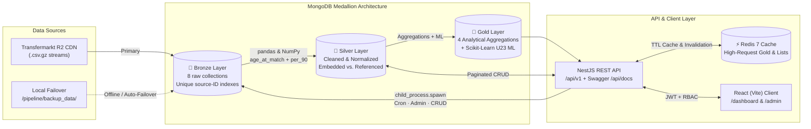

<div align="center">

# ⚽ MercatoIQ

**European Football Performance & Financial Intelligence Platform ("Moneyball" Analytics)**  
*Connecting on-pitch player output with transfer fees and market valuations across the UEFA Champions League & Top 5 European Leagues (2012–present).*

[](https://www.python.org/)
[](https://pandas.pydata.org/)
[](https://scikit-learn.org/)
[](https://nestjs.com/)
[](https://www.mongodb.com/)
[](https://redis.io/)
[](https://vitejs.dev/)

[Architecture](#-medallion--system-architecture) · [4 Analytical Questions](#-the-4-analytical-questions-gold-layer) · [Quick Start](#-quick-start) · [Pipeline CLI](#-data-pipeline-cli--testing) · [Monorepo Structure](#-monorepo-structure) · [Team & Roadmap](#-team--git-flow)

</div>

---

## 🧭 Medallion & System Architecture

MercatoIQ ingests **>100,000 unique observations** from [`dcaribou/transfermarkt-datasets`](https://github.com/dcaribou/transfermarkt-datasets) into a three-tier **MongoDB Medallion Architecture (Bronze -> Silver -> Gold)** orchestrated by Python and served by a **NestJS REST API (`/api/v1`)** backed by **Redis** caching.



---

## 🎯 The 4 Analytical Questions (Gold Layer)

| # | Analytical Question | Gold Collection | Key Metrics Exposed |
| :---: | :--- | :--- | :--- |
| **Q1** | **Club Financial Transfer ROI:** *Which clubs achieve the highest offensive output per million EUR spent on transfer fees?* | `gold_club_transfer_roi` | `total_spend_m_eur`, `total_ga`, `ga_per_m_eur` |
| **Q2** | **U23 Talent Scouting + ML (+5pt Bonus):** *Which U23 players outperform their market value based on `per_90` output and our ML regression model?* | `gold_undervalued_scouting` | `market_value_in_eur`, `fair_market_value_eur`, `valuation_delta` |
| **Q3** | **Big-Match Pressure (UCL vs. Domestic):** *Which players and clubs step up or drop off in the UEFA Champions League (`CL`) vs. Top 5 domestic leagues?* | `gold_ucl_vs_domestic` | `ga_per_90_ucl`, `ga_per_90_domestic`, `pressure_delta` |
| **Q4** | **Late-Game Super-Subs:** *Which substitutes generate the highest rate of decisive goals and assists after the 70th minute?* | `gold_super_subs` | `sub_appearances`, `late_ga_70_plus`, `late_ga_rate` |

---

## 🗄️ Silver Layer Design: Embedded vs. Referenced

| Pattern | Target Collection(s) | Architectural Justification |
| :--- | :--- | :--- |
| **Embedded** | `silver_players` | Embeds `current_club` summary (`{ club_id, name, competition_id }`) and up to 10 recent `market_valuations` snapshots directly inside each player document for single-query profile reads with zero joins. |
| **Referenced** | `silver_appearances`<br/>`silver_transfers` | Uses indexed references (`player_id`, `game_id`, `club_id`, `competition_id`, `season`) + compound indexes (`competition_id, season, player_id, position`) because players accumulate 500+ appearances and clubs have thousands of matches. |

---

## 🚀 Quick Start

### 1. Clone with Submodules & Configure Environment
```bash
git submodule update --init --recursive
cp .env.example .env
```

### 2. Start MongoDB 7 & Redis 7
```bash
docker compose up -d
```
- **`mercatoiq-mongodb`** (`localhost:27017`) automatically runs [`scripts/mongo-init.js`](file:///home/haroune/Documents/TP%20Final%20Collecte/MercatoIQ/scripts/mongo-init.js) to provision collections and unique/compound indexes.
- **`mercatoiq-redis`** (`localhost:6379`) provides AOF-backed caching for high-request Gold analytics and paginated reads.

### 3. Run the Python Data Pipeline (`/pipeline`)
```bash
python3 -m venv .venv
source .venv/bin/activate
pip install -r pipeline/requirements.txt

# Run Bronze ingestion + Silver transformation (or --layer all)
python3 pipeline/run_pipeline.py --trigger manual --layer all
```

### 4. Start the NestJS Backend (`/backend`)
```bash
cd backend
cp .env.example .env
npm install
npm run start:dev
```
- **Healthcheck:** [`http://localhost:3000/api/v1/health`](http://localhost:3000/api/v1/health)
- **Swagger UI:** [`http://localhost:3000/api/docs`](http://localhost:3000/api/docs) *(See [backend/README.md](file:///home/haroune/Documents/TP%20Final%20Collecte/MercatoIQ/backend/README.md) for full API details)*

---

## 🧪 Data Pipeline CLI & Testing

The pipeline orchestrator ([`pipeline/run_pipeline.py`](file:///home/haroune/Documents/TP%20Final%20Collecte/MercatoIQ/pipeline/run_pipeline.py)) records every execution in `pipeline_logs` and supports selective layer execution, offline failover, and row caps for fast dev testing:

```bash
# Quick dev run (cap at 2,000 rows per dataset)
.venv/bin/python pipeline/run_pipeline.py --trigger manual --layer bronze --limit 2000

# Force offline mode (read strictly from /pipeline/backup_data/ failover files)
.venv/bin/python pipeline/run_pipeline.py --trigger manual --layer bronze --offline

# Run only Bronze -> Silver normalization
.venv/bin/python pipeline/run_pipeline.py --trigger manual --layer silver

# Verify Bronze document counts, unique indexes & >100,000 observation requirement
.venv/bin/python pipeline/check_bronze.py

# Run Python unit test suite (Bronze + Silver transformations)
.venv/bin/python -m unittest discover -s pipeline -p "test_*.py" -v
```

---

## 📂 Monorepo Structure

```text
MercatoIQ/
├── backend/                     # [Submodule] NestJS 10 REST API (/api/v1, JWT/RBAC, Mongoose, Redis, Swagger)
├── frontend/                    # [Submodule] React (Vite) Web Client (/dashboard & /admin)
├── pipeline/                    # Python 3 Medallion ETL & Machine Learning Pipeline
│   ├── backup_data/             # Local .csv.gz / .csv failover directory
│   ├── config.py                # Env config, Mongo connection, CDN URLs & collection registry
│   ├── downloader.py            # Atomic R2 CDN downloader with automatic local failover
│   ├── bronze_ingest.py         # Chunked idempotent Bronze ingestion & unique index enforcement
│   ├── silver_transform.py      # Pandas/NumPy cleaning, age_at_match, per_90 & Embedded/Referenced builders
│   ├── run_pipeline.py          # CLI entrypoint invoked by NestJS child_process.spawn
│   ├── check_bronze.py          # Verification CLI for unique indexes & >100k observation target
│   ├── test_bronze.py           # Unit tests for failover, NaN cleaning & deterministic transfer_id
│   └── test_silver.py           # Unit tests for embedded players, per_90 NumPy math & season parsing
├── scripts/
│   └── mongo-init.js            # Docker startup script creating Bronze/Silver/Gold collections & indexes
├── docker-compose.yml           # Local MongoDB 7.0 + Redis 7-alpine services
└── .env.example                 # Root environment variables template
```

---

## 👥 Team & Git Flow

Tracked on our public **[GitHub Project Board — MercatoIQ (420-514)](https://github.com/users/Haroune07/projects/3)**:

| Member | Primary Ownership | Current Status |
| :--- | :--- | :--- |
| **`@Haroune07`** | Monorepo Infra, Docker, Python Pipeline (Bronze / Silver / Gold / ML) | ✅ `INFRA-01`, `BACK-01`, `PIPE-01`, `PIPE-02` Done · 🔜 `PIPE-03` (Gold + ML) |
| **`@amineelghazi`** | Mongoose Schemas (Silver/Gold), Paginated CRUD, Gold API & Redis Cache | 🔜 `BACK-02`, `BACK-03`, `BACK-04`, `BACK-05` |
| **`@ddryad`** | Auth JWT/Bcrypt, RBAC (`user`/`admin`), API Security, Pipeline Spawn & React Core | ✅ `SEC-01` Merged · 🔜 `SEC-02`, `FRONT-01`, `OPS-01` |
| **`@Sirmator`** | React UI Views (`Login`/`Register`, `/dashboard` 4 Gold Charts, CRUD Modals & `/admin`) | 🔜 `FRONT-02`, `FRONT-03`, `FRONT-04` |

### Branching Convention
- **`main`** — Stable production & milestone releases.
- **`develop`** — Active integration branch.
- **`feature/<ticket-id>-<short-name>`** — Per-issue feature branches *(e.g., `feature/pipe-01-bronze`, `feature/pipe-02-silver`, `feature/SEC-01`)*.
